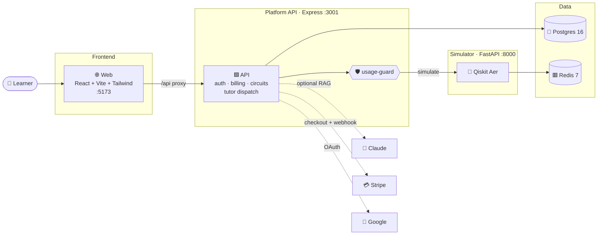
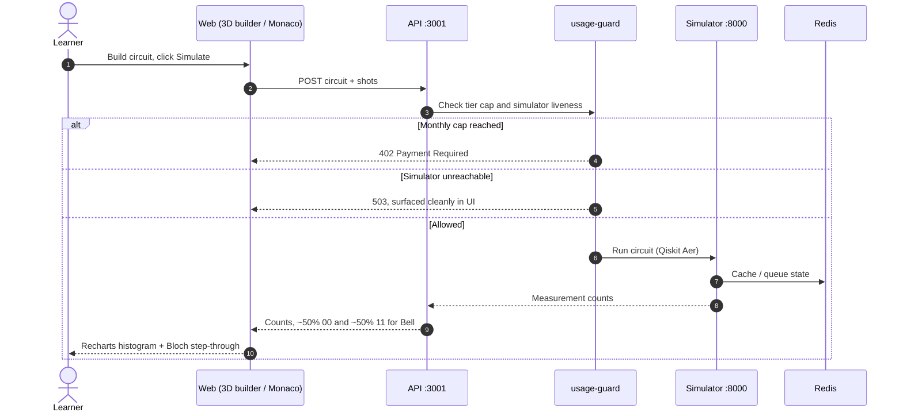
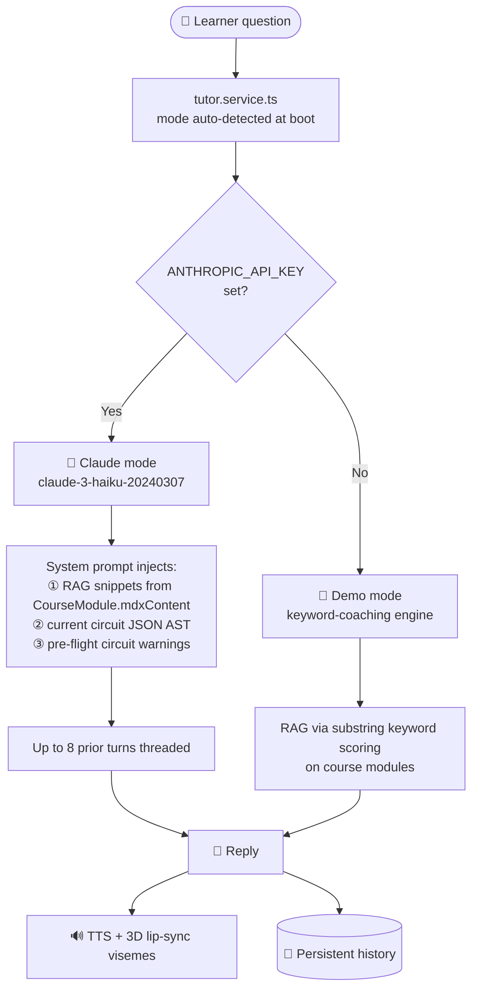

<div align="center">


<h1>QVANTA</h1>

<b>learn quantum computing by building it in 3D</b>

<br/><br/>



<br/>


<br/><br/>

**A production-grade, multi-tenant SaaS platform for interactive quantum computing education.**

<br/>

[**⚡ Quick Start**](#-quick-start) &nbsp;•&nbsp; [**🧬 Features**](#-features) &nbsp;•&nbsp; [**🔀 Workflow**](#-workflow) &nbsp;•&nbsp; [**🎓 Learning Lab**](#-learning-lab) &nbsp;•&nbsp; [**💎 Plans**](#-tiered-plans) &nbsp;•&nbsp; [**🧭 Roadmap**](#-roadmap) &nbsp;•&nbsp; [**🛠️ Deploy**](#%EF%B8%8F-reproducible-checks--deployment)

<br/>

<table>
  <tr>
    <td align="center"><h2>527</h2><sub>CURRICULUM MODULES</sub></td>
    <td align="center"><h2>39</h2><sub>COURSE PARTS</sub></td>
    <td align="center"><h2>3</h2><sub>SERVICES</sub></td>
    <td align="center"><h2>65,536</h2><sub>MAX SHOTS (PRO)</sub></td>
  </tr>
</table>

</div>


## 🧬 Features

<table>
  <tr>
    <td width="33%" valign="top">
      <h3>🧱 3D Circuit Builder</h3>
      Drag-drop gates on qubit rails with React Three Fiber. Gate snap, keyboard nav and a 2D fallback.
    </td>
    <td width="33%" valign="top">
      <h3>🧑‍💻 Monaco Qiskit Editor</h3>
      Bidirectional sync with the 3D scene, with parse-error markers right in the editor.
    </td>
    <td width="33%" valign="top">
      <h3>📊 Qiskit Aer Simulation</h3>
      Fast simulation with measurement histograms rendered through Recharts.
    </td>
  </tr>
  <tr>
    <td width="33%" valign="top">
      <h3>🔮 Bloch Spheres</h3>
      Animated, per-qubit, with step-through playback of every gate.
    </td>
    <td width="33%" valign="top">
      <h3>🧑‍🏫 3D AI Tutor</h3>
      A virtual human with lip-sync and optional Claude RAG.
    </td>
    <td width="33%" valign="top">
      <h3>💳 Stripe Billing</h3>
      Free and Pro tiers with webhook-driven upgrades and usage caps.
    </td>
  </tr>
</table>


## 🔀 Workflow

### 1 · System Architecture



### 2 · Simulation Flow



### 3 · AI Tutor Dual Path




## 🗂️ Monorepo Structure

```
.
├── apps/
│   ├── web/          # React + Vite + Tailwind frontend (3D builder, Monaco, tutor)
│   ├── api/          # Node.js Express platform API (auth, billing, circuits, tutor dispatch)
│   └── simulator/    # Python FastAPI quantum simulation microservice (Qiskit Aer + Redis)
├── packages/
│   ├── types/        # Shared TypeScript types (Circuit, GateOp, TutorMessage, etc.)
│   └── ui/           # Shared React component library + Tailwind preset
└── infra/
    ├── docker-compose.yml        # Postgres 16 + Redis 7 (pgvector optional)
    ├── api/Dockerfile            # API service image
    ├── simulator/Dockerfile      # Simulator microservice image
    ├── web/Dockerfile            # Web frontend image
    └── .github/workflows/ci.yml  # CI gates; release.yml publishes tagged web images
```


## ⚡ Quick Start

> **10 steps · 5–10 minutes**

### `01` &nbsp; Prerequisites

Docker + Docker Compose, Node.js 20 (pinned in `.nvmrc`), Python 3.11+, npm.

### `02` &nbsp; Start infrastructure

Postgres + Redis (pgvector is optional):

```bash
docker compose -f infra/docker-compose.yml up -d
```

### `03` &nbsp; Install npm dependencies

At the monorepo root:

```bash
npm ci
```

### `04` &nbsp; Copy and fill the env templates

Leave third-party keys blank for demo mode.

```bash
cp apps/api/.env.example apps/api/.env
cp apps/web/.env.example apps/web/.env
cp apps/simulator/.env.example apps/simulator/.env
```

> [!TIP]
> For the checked-in 527-module curriculum, keep `SEED_CURRICULUM=1` in `apps/api/.env`. The API seeds stable numeric module ids so lesson progress, checkpoints, and tutor retrieval share the same source-backed curriculum.

> [!NOTE]
> **Demo mode:** the platform runs without `GOOGLE_*`, `STRIPE_*`, or `ANTHROPIC_API_KEY`. Stripe CTA buttons are still present, and the tutor falls back to a keyword-driven canned-reply path.

On a local web host (`localhost`, `127.0.0.1`, or `::1`), the login page exposes a development-only demo ID so the authenticated UI can be tried without the API:

<div align="center">

| 🪪 Field | 🔐 Value |
|:---:|:---:|
| Email | `dev@qvanta.ai` |
| Password | `dev-password` |

</div>

> [!WARNING]
> This account is not a production identity and must not be enabled or reused as a real deployment credential.

### `05` &nbsp; Install Python simulator dependencies

*Optional: usage-guard already validates simulator liveness at request time, so skip this for a quick smoke-test.*

```bash
cd apps/simulator
python -m venv .venv && source .venv/bin/activate  # Windows: .venv\Scripts\activate
pip install -r requirements.txt
```

### `06` &nbsp; Initialize Prisma schema and run migrations

```bash
npm --workspace api run prisma:generate
npm --workspace api run prisma:migrate
```

### `07` &nbsp; Start the FastAPI simulator

Terminal 1, or in the background:

```bash
# From apps/simulator with venv active:
uvicorn app.main:app --reload --host 0.0.0.0 --port 8000
```

If the Python env is not set up, the API still boots; simulator requests return a `503` that surfaces cleanly in the UI.

### `08` &nbsp; Start the Node platform API

Terminal 2:

```bash
npm --workspace api run dev
```

Listens on `http://localhost:3001`. Seeds an admin user from `ADMIN_EMAIL` / `ADMIN_PASSWORD_HASH` on first boot.

### `09` &nbsp; Start the Vite web frontend

Terminal 3:

```bash
npm --workspace web run dev
```

Vite proxies `/api` → `localhost:3001`. Open **http://localhost:5173** 🎉

### `10` &nbsp; Smoke-test the MVP happy path

<details open>
<summary><b>✅ Checklist (click to collapse)</b></summary>

<br/>

| Step | What to do | Expect |
|:---:|---|---|
| **1** | Register a local email/password user | No Google OAuth needed for dev |
| **2** | Open the Dashboard | Modules list + usage meter `0/50` (Free tier) |
| **3** | **Circuit Builder** → drag `H` onto `q0·t0`, `CNOT(q0→q1)` to `t1`, add `Measure` on both at `t2` → **Simulate** (1024 shots) | Bell histogram: ~50% `00`, ~50% `11` |
| **4** | **AI Tutor** → ask *"What does H do?"* | Reply includes **"superposition"** → TTS plays → mouth visemes animate closed/A/O → history persists after refresh |
| **5** | **Billing** page → click Upgrade | Free tier shown; Stripe checkout opens (mocked session in test mode) |

</details>


## 🎓 Learning Lab

The authenticated **Learn** workspace lives at `/learn` and is linked from the sidebar. It provides a guided learning loop without replacing the existing Dashboard, Circuit Builder, or AI Tutor.

| | Section | Details |
|:---:|---|---|
| 🗺️ | **Roadmap** | Four beginner-friendly chapters with short lesson steps, resumable progress, prediction checkpoints, mastery, XP, and a 3D Bloch-sphere-style state playground. Apply H, measure, reset, and orbit the scene with the pointer. |
| 🔄 | **Progress sync** | The web client prefers authenticated `/lessons/progress` persistence and falls back to versioned browser storage when the API is unavailable. The API stores last step, checkpoint state, mastery, XP, and attempt history per learner. |
| ✔️ | **Checkpoints** | Source-backed course checkpoints are derived from explicit lesson checkpoint content. Structured quizzes can provide answer keys; checklist content is self-attested rather than scored from invented answers. |
| 🏆 | **Contests** | Beginner/intermediate challenge briefs with filters and local join/leave state. Use Circuit Builder to create the actual circuit for a challenge. |
| 💬 | **Discussions** | Searchable topic filters, local upvotes, thread preview, and a local composer for practicing explanations before a backend discussion service is connected. |
| 📖 | **Full Curriculum** | The authenticated `/curriculum` explorer renders the attached, source-backed **39-part / 527-module** curriculum with search, part and level filters, progress, sequential navigation, exact section content, module-specific circuits, checkpoints, and a handoff into the virtual tutor. |

The public `/` landing page previews these three entry points and the visual-learning approach. Existing `/home` showcase sections remain available from the landing page.


## 💎 Tiered Plans

<div align="center">

| Tier | Sims / month | Max shots | Builder | Tutor | Instructor panels |
|:---:|:---:|:---:|:---:|:---:|:---:|
| 🆓 **Free** | 50 | 1,024 | 3D + 2D | Demo mode | — |
| ⚡ **Pro** | Unlimited | 65,536 | 3D + 2D | Claude RAG | — |
| 🏫 **Inst.** | Per seat | 65,536 | 3D + 2D | Claude RAG | Classroom dash |

</div>


## 🤖 AI Tutor: Dual-Path Mode

`tutor.service.ts` in `apps/api` operates in two modes, auto-detected at boot:

<table>
  <tr>
    <td width="50%" valign="top">
      <h3>🧠 Claude mode</h3>
      <b>Trigger:</b> <code>ANTHROPIC_API_KEY</code> is set<br/><br/>
      Calls <code>claude-3-haiku-20240307</code> with a system prompt that injects:
      <ol>
        <li>Course-module/keyword RAG snippets from <code>CourseModule.mdxContent</code></li>
        <li>The current circuit JSON AST</li>
        <li>Pre-flight heuristic circuit warnings: missing Measure gates, self-target CNOT, out-of-range qubit indices</li>
      </ol>
      Up to 8 prior turns are threaded for context.
    </td>
    <td width="50%" valign="top">
      <h3>🧩 Demo mode</h3>
      <b>Trigger:</b> no key<br/><br/>
      Falls back to an enhanced keyword-coaching engine, so tutor UX works fully locally without secrets.<br/><br/>
      RAG uses substring keyword scoring on course modules.
    </td>
  </tr>
</table>


## ✅ MVP Checklist

- [x] Monorepo with `apps/{web,api,simulator}`, `packages/{ui,types}`, `infra/`
- [x] Register / login, Google OAuth routes, JWT refresh, role-based guards
- [x] 3D drag-drop builder with qubit rails, gate snap, keyboard nav, 2D fallback
- [x] Monaco ↔ 3D scene sync with parse-error markers
- [x] Bell circuit simulation with Recharts histogram
- [x] Tutor with TTS, lip-sync and persistent history
- [x] Stripe Free/Pro tiers, webhook → tier, usage guard returns `402` at cap
- [x] Per-qubit Bloch spheres with step-through animation
- [x] Mobile-responsive sidebar and Lite 2D toggle
- [x] `types`/`ui` build, `api` typecheck and `web` build all pass


## 🧭 Roadmap

- [ ] 🏫 Instructor classroom dashboard
- [ ] 🔌 More simulator backends (PennyLane, Cirq)
- [ ] 🔒 Org-scoped tenant isolation hardening
- [ ] 🧮 Deeper algorithm modules (Grover, QFT, VQE)


## 🛠️ Reproducible Checks & Deployment

From the repository root, with dependencies installed from `package-lock.json`:

```bash
# Install exactly the versions recorded in package-lock.json.
npm ci

# The offline-friendly repository, typecheck, and production-build checks.
npm test
npm run prisma:generate
npm run typecheck
npm run build

# The complete repository check target, including Prisma client generation.
make test
```

> [!NOTE]
> `npm test` validates the workspace and lockfile metadata without network access. After dependencies have been installed, Prisma generation, typechecking, and building also run locally without calling application services. `make test` runs the repository verification, Prisma generation, typecheck, and build. The equivalent commands are shown above when GNU Make is not available.

### 🐳 Production web container

Build and run with the repository Dockerfile:

```bash
make docker-check
# or: npm run docker:check
docker run --rm -p 8080:80 qvanta-web:ci
```

Open **http://localhost:8080**. The nginx configuration falls back to `index.html`, so client-side routes such as `/learn` continue to work after a refresh.


## 📚 Documentation

| Doc | Covers |
|---|---|
| [`docs/architecture.md`](docs/architecture.md) | Current runtime and workspace boundaries |
| [`docs/ci-cd.md`](docs/ci-cd.md) | CI gates, GHCR publishing, and deployment limitations |
| [`docs/product-baseline.md`](docs/product-baseline.md) | Product baseline and non-functional requirements |
| [`docs/security-privacy.md`](docs/security-privacy.md) | Secrets, data-flow, and privacy boundaries |
| [`CONTRIBUTING.md`](CONTRIBUTING.md) | Contribution and release expectations |
| [`SECURITY.md`](SECURITY.md) | Vulnerability reporting and security boundaries |

## ⚖️ Legal

Public legal baseline pages are available at `/terms` and `/privacy`. They are plain-language templates with intentional placeholder contact details. **Replace them and obtain counsel review before a production launch.**

<div align="center">

<br/>


<sub>`|ψ⟩ = (|0⟩ + |1⟩) / √2` &nbsp;·&nbsp; **built for curious minds**</sub>

</div>
